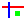
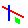
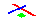
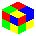

# Isometrify

An [Aseprite](https://aseprite.org) extension that projects flat pixel
art onto the planes of a **2:1 isometric scene** — walls and floors.
For a wall it does the thing you would otherwise do by hand: select the
rightmost two-pixel strip and nudge it down one, then the rightmost four
and nudge down one, then six, eight, and so on. The plugin runs every
pass in one click.

| flat                           | after _Isometrify_             |
| ------------------------------ | ------------------------------ |
|  |  |

| flat                           | after _Isometrify Floor_         |
| ------------------------------ | -------------------------------- |
|  |  |

And the three commands on one square assemble into a cube:



(On a wall the horizontal stripe turns into the classic 2:1 staircase
while the vertical stripe stays perfectly vertical; on the floor both
stripes become staircases and the drawing lies flat as a diamond.)

## Usage

No dialog, no settings. Select a portion of your drawing — or select
nothing to transform the whole active cel — and run one of the
commands (they sit right after the Shift submenu, among the transform
commands):

| Command                       | Plane           | Result                                |
| ----------------------------- | --------------- | ------------------------------------- |
| _Edit > Isometrify_           | front wall      | horizontals become `\` 2:1 staircases |
| _Edit > Isometrify Left Wall_ | left wall       | the mirrored wall: `/` staircases     |
| _Edit > Isometrify Floor_     | floor / ceiling | the drawing becomes a flat diamond    |

These three planes are all a 2:1 isometric scene has: the other two
walls of a room are the same two orientations as the front and left
walls, and a ceiling is the same plane as the floor. Flip the drawing
first if you need a mirrored wall or the other side of a ceiling —
and see _Assembling a cube_ below for how the three commands on one
square fit together.

All commands behave the same way:

- only the pixels inside take part: the shear is counted from the
  drawing's own edge, so extra empty margin inside a bigger selection
  changes nothing
- the canvas grows if the result needs room
- the result stays selected, so you can nudge it into place
- the whole step is a single undo

**Hotkeys:** _Edit > Keyboard Shortcuts_ → search for **Isometrify** →
press your key combination. Every Aseprite command can be bound; that
is all a plugin can do to support hotkeys.

## How it works

### Walls

An isometric wall is a pure _vertical shear_ of flat art, so no rotation
or scaling is involved:

- vertical lines stay vertical;
- horizontal lines become the classic 2:1 staircase (two across, one
  down);
- pixel column `x` slides down by `floor(x/2)` (front wall) or
  `floor((w-1-x)/2)` (left wall), so pairs of columns share each step;
- the result's bounding box grows taller by about half the width.

Every source pixel lands on exactly one destination pixel — nothing is
scaled, duplicated or dropped — which makes the transform lossless in
all color modes (RGBA, Grayscale, Indexed) and exactly reversible. That
is also why the hand technique works: each "select more, nudge down"
pass pushes every earlier strip one row further down, so strip pair `i`
ends up exactly `i` rows lower.

### Floor

The floor is not a shear, but it is the same kind of trick: mostly a
pure pixel move. Every texture pixel is moved to exactly one output
pixel along the continuous projection

- texture pixel `(u, v)` → `(u − v, (u+v)/2)`: the drawing's x runs
  down-right, its y runs down-left;
- a `w × h` region becomes a diamond `w + h` wide and `(w + h)/2`
  tall — a 16×16 square becomes 32×16;
- the diamond is rasterized with **full coverage**: a solid outline with
  2-pixel-wide tips, spanning exactly as wide as the two walls of the
  same drawing side by side. Each row's outermost pixel is repeated
  once at each flank to keep that outline solid, so a 16×16 floor is
  256 moved pixels plus 32 outline copies.

One lattice quirk: a texture pixel with odd `u + v` falls between two
pixel rows, so those diagonals are dealt out row by row until the
diamond is full (at most one pixel of adjustment each, near the right
corner). The floor is therefore not exactly reversible (undo still
works, of course).

### Assembling a cube

Take one square drawing (say `S × S`, like 16×16) and isometrify it
three ways. Place the results like this — no flipping needed:

- the floor diamond at `(X, Y)`: it is `2S` wide and `S` tall;
- _Isometrify_ (the `\` wall) at `(X, Y + S/2 + 1)`: it hangs from the
  diamond's front-left edge;
- _Isometrify Left Wall_ (the `/` wall) at `(X + S, Y + S/2 + 1)`: it
  hangs from the front-right edge.

The walls sit side by side, their front edges forming a 4-pixel flat —
and the diamond's bottom tip is that same 4-pixel flat, so the
proportions of the cube line up (that is what the full-coverage
outline is for). The test suite renders exactly this as
`docs/example_cube.png`.

## Notes & limits

- The transform is **drawn over** existing pixels: opaque pixels of the
  result replace what is under them, but transparent parts do not erase
  art outside the source region (the source region itself is always
  cleared first).
- The selection is a **window over the drawing**: it is used as its
  bounding rectangle (a mask-shaped selection is treated as its
  bounding box), and the transform is counted from the edges of the
  pixels inside it — empty margin inside a bigger selection is
  neither shifted nor cleared. A selection that holds no pixels fails
  with a message instead of doing anything.
- It operates on the **active layer and frame** only.
- Linked cels share their image; treat the plugin like any edit if you
  use linked cels across frames.

## Developing

```sh
cd test
/path/to/aseprite -b -script test_isometrify.lua   # 43-check test suite
/path/to/aseprite -b -script probe.lua            # API capability probe
```

`isometrify.lua` doubles as a library: loading it only defines
`ISOMETRIFY.transform` / `ISOMETRIFY.apply` plus the `init(plugin)` hook
that registers the menu commands — nothing runs at load time. The
commands expose the front wall, the left wall and the floor; the
library also keeps `reverse` (un-shear) for the tests and future modes.

## Ideas for later

- Multi-layer mode; mask-accurate (non-rectangular) regions.
